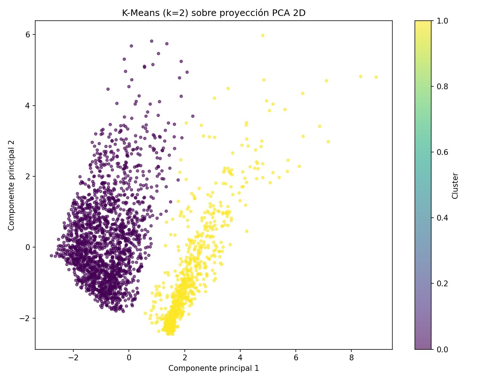
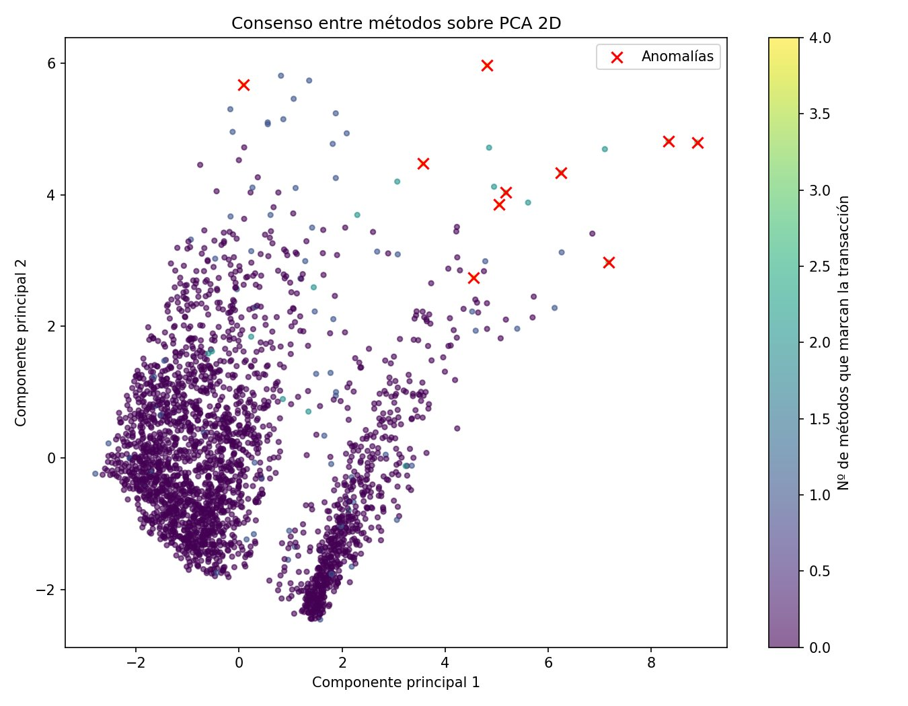
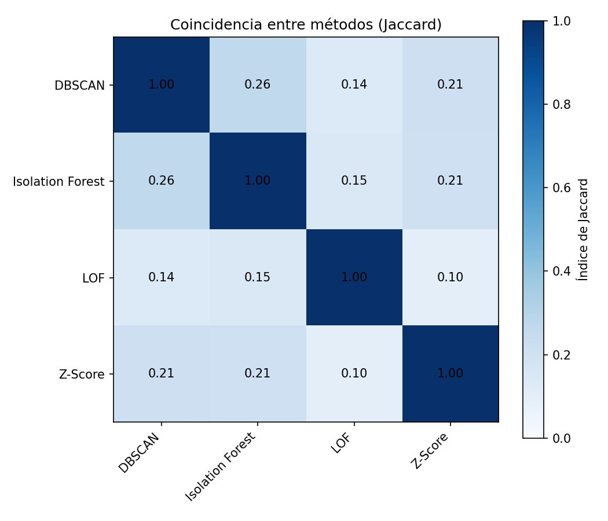
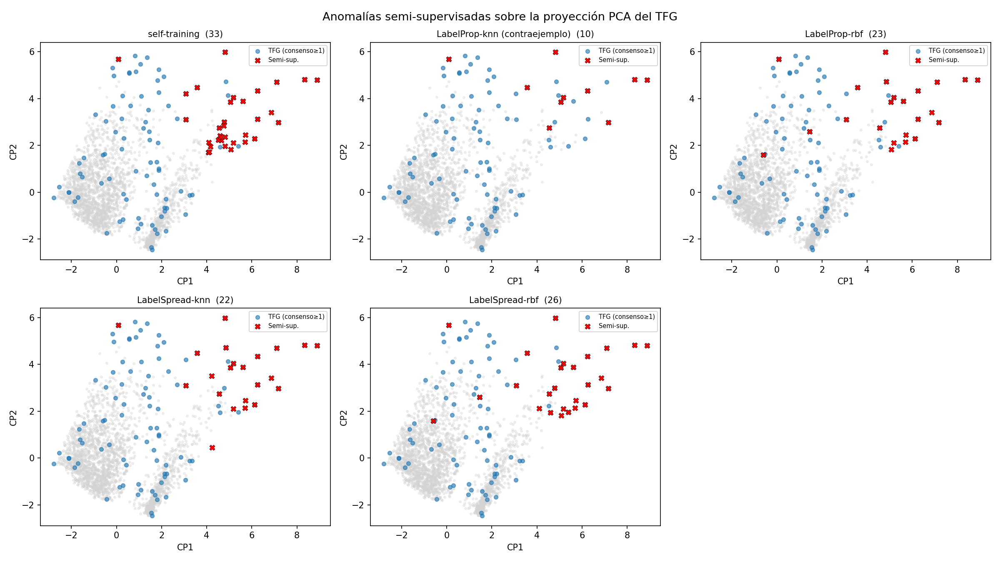

# Clustering para la detección de transacciones fraudulentas en entidades bancarias

> *Clustering for the Detection of Fraudulent Transactions in Banking Institutions*


Trabajo Fin de Grado (TFG) y su complemento (CTFG) del **Grado en Ingeniería
Informática** de la **Universidad de Almería**. El proyecto aborda la detección
de transacciones bancarias fraudulentas mediante **aprendizaje automático no
supervisado** (clustering y detección de anomalías) y lo **extiende con un
enfoque semi-supervisado**.

Este repositorio reúne **todo el código, las figuras y los resultados** para
poder **reproducir de principio a fin** los experimentos descritos en ambas
memorias.

- **Autor:** Pablo Fernández Valverde
- **Directores:** Antonio Becerra Terón · Rafael Guirado Clavijo
- **Universidad:** Universidad de Almería — Escuela Superior de Ingeniería

---

## Índice

- [Contexto y objetivos](#contexto-y-objetivos)
- [Estructura del repositorio](#estructura-del-repositorio)
- [Conjunto de datos](#conjunto-de-datos)
- [Requisitos e instalación](#requisitos-e-instalación)
- [Cómo reproducir los experimentos](#cómo-reproducir-los-experimentos)
- [Metodología](#metodología)
- [Resultados](#resultados)
- [Galería de figuras](#galería-de-figuras)
- [Memorias](#memorias)
- [Cómo citar](#cómo-citar)
- [Licencia](#licencia)

---

## Contexto y objetivos

La detección de fraude es uno de los retos de mayor impacto económico para el
sector bancario. En el escenario habitual, las operaciones **no disponen de una
etiqueta** que las identifique como fraudulentas o legítimas, por lo que el
aprendizaje **no supervisado** resulta especialmente adecuado.

El proyecto se divide en dos partes:

1. **TFG — enfoque no supervisado** (`pipeline_fraude.py`). Se diseña, implementa
   y compara de forma sistemática un conjunto de técnicas no supervisadas de
   agrupamiento y de detección de anomalías sobre un conjunto de **2 512
   transacciones** bancarias, y se articula un esquema de **consenso** para
   destilar las operaciones más sospechosas sin disponer de etiquetas.

2. **CTFG — complemento semi-supervisado** (`complemento_semisupervisado.py`).
   Se reutiliza el consenso del TFG como fuente de unas pocas **etiquetas
   semilla fiables** y se aplican y comparan tres familias de métodos
   **semi-supervisados** para generalizar el patrón de fraude a todo el
   conjunto a partir de muy pocas etiquetas.

> **Nota metodológica importante.** El conjunto de datos no contiene una verdad
> de fraude real. Las "etiquetas" del complemento provienen del consenso de los
> métodos no supervisados, por lo que las métricas **no deben interpretarse como
> aciertos absolutos**: el estudio se centra en *qué aporta* el enfoque
> semi-supervisado frente al no supervisado (capacidad de generalizar,
> operaciones nuevas que descubre y sensibilidad a la semilla).

---

## Estructura del repositorio

```
clustering-deteccion-fraude-tfg/
├── pipeline_fraude.py              # TFG  — pipeline no supervisado (clustering + anomalías)
├── complemento_semisupervisado.py  # CTFG — extensión semi-supervisada (importa el anterior)
├── requirements.txt                # Dependencias
├── data/
│   └── README.md                   # Cómo descargar el dataset (no se redistribuye)
├── figuras/                        # Las 14 figuras generadas por los scripts (referencia)
│   ├── 01_distribuciones_numericas.png  …  12_consenso_pca.png
│   └── 13_pca_semi_vs_tfg.png / 14_pca_metodos_semi.png
├── resultados/                     # Salidas de referencia de los scripts
│   ├── resultados_pipeline.csv     # etiquetas/consenso del TFG (2 512 filas)
│   └── resultados_complemento.csv  # resultados del complemento semi-supervisado
├── LICENSE
└── README.md
```

---

## Conjunto de datos

Se utiliza el dataset público **Bank Transaction Dataset for Fraud Detection**
(Valakhorasani, Kaggle). **No se incluye** en el repositorio; las instrucciones
de descarga y la descripción de las 16 variables están en
[`data/README.md`](data/README.md).

Resumen: **2 512 transacciones × 16 variables**, sin etiqueta de fraude.

---

## Requisitos e instalación

- **Python 3.9 o superior**
- Dependencias: `numpy`, `pandas`, `matplotlib`, `scikit-learn`

```bash
# (recomendado) crear un entorno virtual
python -m venv .venv
source .venv/bin/activate        # en Windows:  .venv\Scripts\activate

# instalar dependencias
pip install -r requirements.txt
```

---

## Cómo reproducir los experimentos

1. Descarga el dataset y colócalo como `bank_transactions_data_2.csv` en la
   **raíz** del repositorio (ver [`data/README.md`](data/README.md)).

2. **Parte no supervisada (TFG).** Genera las figuras `01`–`12` (en `figuras/`)
   y el fichero `resultados_pipeline.csv`:

   ```bash
   python pipeline_fraude.py
   ```

3. **Parte semi-supervisada (CTFG).** Reutiliza `resultados_pipeline.csv`,
   genera las figuras `13`–`14` y el fichero `resultados_complemento.csv`:

   ```bash
   python complemento_semisupervisado.py
   ```

Ambos scripts fijan `random_state=42`, por lo que los resultados son
**reproducibles**. Las salidas que generan coinciden con las copias de
referencia incluidas en `figuras/` y `resultados/`.

---

## Metodología

### TFG — aprendizaje no supervisado (`pipeline_fraude.py`)

La clase `PipelineFraude` implementa el flujo completo siguiendo la estructura de
la memoria:

| Fase | Técnica | Figuras |
|---|---|---|
| Análisis exploratorio (EDA) | Distribuciones y correlaciones | `01`, `02`, `03` |
| Agrupamiento | **K-Means** (selección de *k* por codo + silueta) | `04`, `05` |
| Agrupamiento | **DBSCAN** (estimación de *eps* por k-distancias) | `06`, `07` |
| Detección de anomalías | **Isolation Forest** | `08`, `09` |
| Detección de anomalías | **Local Outlier Factor (LOF)** | `10` |
| Detección de anomalías | **Z-Score** | — |
| Comparativa y validación | Similitud de **Jaccard** + **consenso** | `11`, `12` |

### CTFG — aprendizaje semi-supervisado (`complemento_semisupervisado.py`)

A partir de las etiquetas semilla derivadas del consenso del TFG se aplican y
comparan:

- **Self-training** (con un *Random Forest* como clasificador base)
- **Label Propagation** y **Label Spreading** (propagación por vecindad)
- **PU-learning** (*Positive-Unlabeled*, formulación de Elkan y Noto)

bajo varias configuraciones de semilla, contrastándolas con el resultado del TFG
(figuras `13` y `14`).

---

## Resultados

- **K-Means** revela la estructura demográfica mayoritaria del conjunto.
- Los **detectores de anomalías** (Isolation Forest, LOF, Z-Score) identifican,
  desde fundamentos distintos, un **perfil de operación sospechosa coherente**:
  importes elevados en relación con el saldo de la cuenta, a menudo acompañados
  de múltiples intentos de acceso. La baja coincidencia entre métodos (Jaccard)
  evidencia su **complementariedad**, y un esquema de **consenso** destila el
  reducido grupo de operaciones señaladas por varias técnicas a la vez.
- En el **complemento**, el enfoque semi-supervisado demuestra su capacidad de
  **generalizar el patrón de fraude a partir de muy pocas etiquetas** y de
  descubrir operaciones nuevas que el consenso no supervisado había pasado por
  alto: el **perfil** es el resultado **robusto** y el **recuento**, el frágil.
  **PU-learning** aporta un núcleo preciso y conservador, mientras que el
  **self-training** extiende la detección a los casos fronterizos.

Los resultados numéricos completos (etiquetas por transacción, puntuaciones y
consenso) están en [`resultados/`](resultados/).

<p align="center">
  
  
</p>
<p align="center">
  
  
</p>

---

## Galería de figuras

Todas las figuras están en [`figuras/`](figuras/):

| # | Figura | # | Figura |
|---|---|---|---|
| 01 | Distribuciones numéricas | 08 | Isolation Forest — puntuaciones |
| 02 | Distribuciones categóricas | 09 | Isolation Forest — PCA |
| 03 | Matriz de correlación | 10 | Local Outlier Factor — PCA |
| 04 | Codo y silueta (K-Means) | 11 | Jaccard entre métodos |
| 05 | K-Means — PCA | 12 | Consenso — PCA |
| 06 | k-distancias (DBSCAN) | 13 | Semi-supervisado vs TFG — PCA |
| 07 | DBSCAN — PCA | 14 | Métodos semi-supervisados — PCA |

---

## Memorias

El desarrollo completo (marco teórico, metodología detallada, análisis y
conclusiones) está en las memorias del TFG y del complemento. *(Los PDFs se
entregan por el sistema oficial de la Universidad; pueden añadirse a este
repositorio si se desea.)*

---

## Cómo citar

```bibtex
@thesis{fernandez2026clustering,
  author = {Fern{\'a}ndez Valverde, Pablo},
  title  = {Clustering para la detecci{\'o}n de transacciones fraudulentas en entidades bancarias},
  school = {Universidad de Almer{\'i}a},
  year   = {2026},
  type   = {Trabajo Fin de Grado},
  note   = {Directores: Antonio Becerra Ter{\'o}n y Rafael Guirado Clavijo}
}
```

---

## Licencia

Código distribuido bajo licencia **MIT** (ver [`LICENSE`](LICENSE)). El conjunto
de datos pertenece a su autor original en Kaggle y está sujeto a sus propios
términos de uso.
